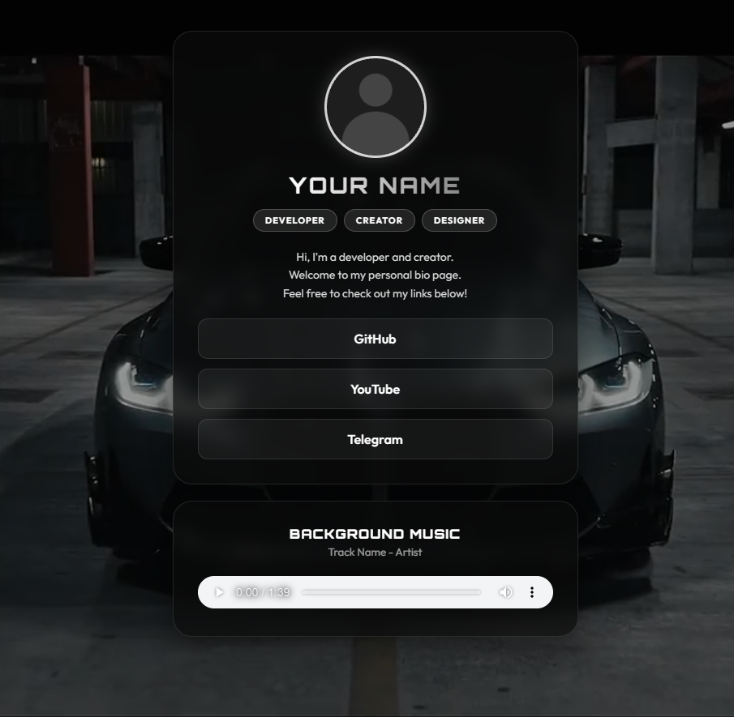

# Link-in-Bio Template

<p align="center">
  <a href="https://google.com/chrome"></a>
  <a href="https://developer.mozilla.org/ru/docs/Web/CSS"></a>
  <a href="https://developer.mozilla.org/ru/docs/Web/HTML"></a>
  <a href="https://developer.mozilla.org/ru/docs/Web/CSS"></a>
  <a href="LICENSE"></a>
</p>

Стильный, ультрасовременный и полностью открытый шаблон персональной страницы-визитки "Link-in-Bio" для разработчиков, дизайнеров, контент-мейкеров и стримеров.

Сочетает передовой дизайн в стиле **Glassmorphism**, динамический циклический видео-фон, физичный 3D-наклон карточки вслед за курсором мыши, кастомную типографику и встроенный стилизованный аудиоплеер для фонового саундтрека.

<p align="center">
  
</p>

## Основные возможности

* **Динамический видео-фон**: Бесшовное воспроизведение зацикленного `.mp4` видеоролика на заднем плане с мягким затемнением для читаемости текста.
* **Физичный 3D-эффект наклона (Tilt)**: Плавное интерактивное вращение карточки профиля с эффектом глубины и блика при движении курсора.
* **Глубокий Glassmorphism**: Эстетичные полупрозрачные поверхности с аппаратным размытием подложки (`backdrop-filter`) и акцентными градиентными рамками.
* **Встроенный музыкальный плеер**: Лаконичный аудиоплеер для фоновой музыки со стилизованной анимацией и кнопками управления звуком.
* **Полная мобильная оптимизация**: Идеальный адаптивный вид на мониторах любого разрешения, смартфонах iPhone и Android.
* **Zero Config**: Чистый HTML, CSS и Vanilla JS — моментальный запуск без Node.js, npm и сложных сборщиков.

## Быстрый старт

### 1. Клонирование репозитория
```bash
git clone https://github.com/KreziBro/link-in-bio-template.git
cd link-in-bio-template
```

### 2. Замена медиафайлов
Поместите свои медиафайлы в корень проекта, заменив стандартные:
* `avatar.png` — ваша фотография или аватар профиля
* `bg_video.mp4` — фоновый видеоролик высокой четкости
* `bg_music.ogg` — фоновый музыкальный трек для аудиоплеера

### 3. Настройка содержимого
Откройте `index.html` в любом текстовом редакторе и настройте данные:
* Имя / Псевдоним
* Ключевые роли и теги (`Developer`, `Creator`, `Designer`)
* Текстовое описание профиля
* Ссылки на социальные сети и проекты (GitHub, Telegram, Discord, YouTube, Steam)

### 4. Публикация в сети
Проект готов к моментальному бесплатному размещению на:
* **GitHub Pages** (Settings → Pages → Branch: `main`)
* **Vercel** / **Netlify** / **Cloudflare Pages**

## Кредиты и благодарности

Дизайн вдохновлен концептом FrizeDev. Переработан KreziBro в универсальный, очищенный и оптимизированный шаблон с открытым исходным кодом.

## Сообщество и поддержка

* Официальный Telegram канал разработчика: https://t.me/KreziBro_dev
* Поддержать развитие проекта на платформе Ko-fi: https://ko-fi.com/krejzibro

## Лицензия

Распространяется под лицензией MIT. Подробности в файле [LICENSE](LICENSE).
